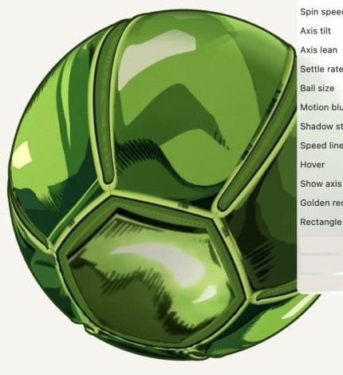
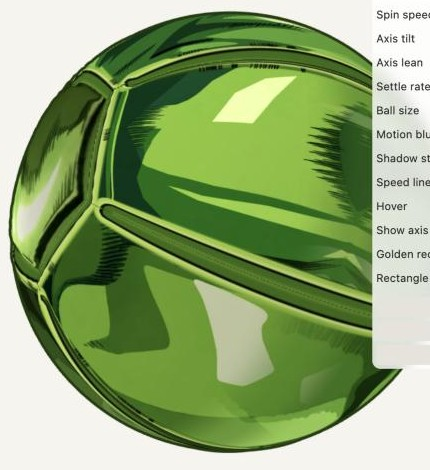
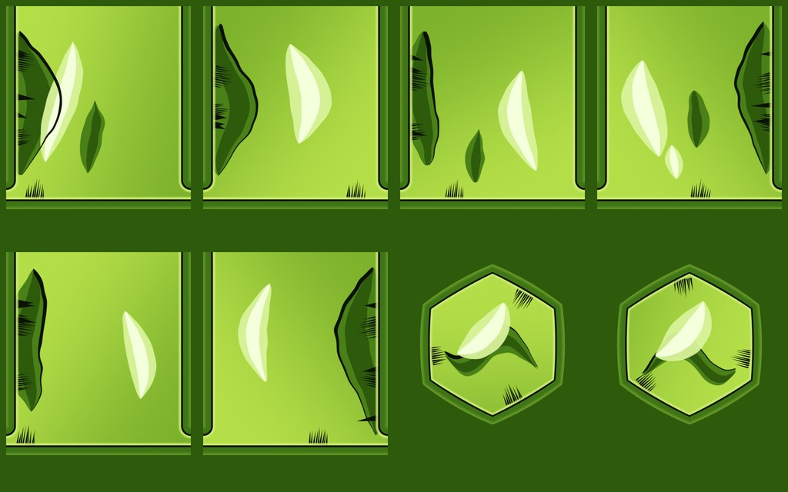
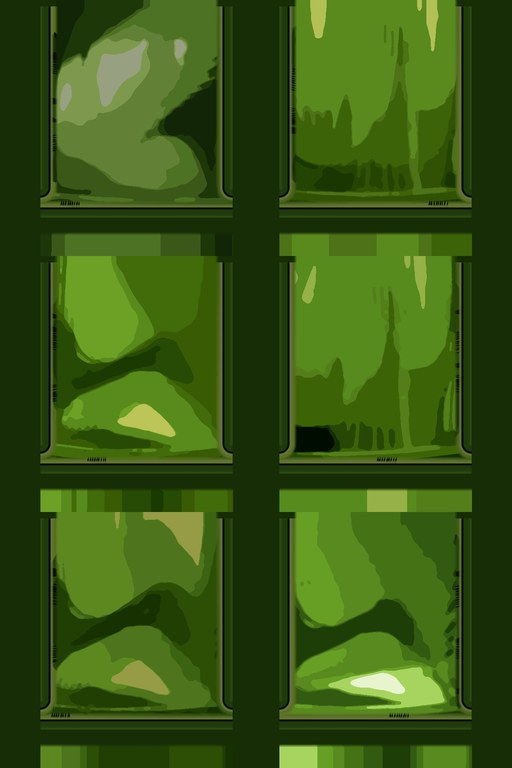
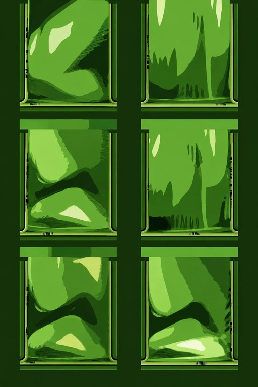
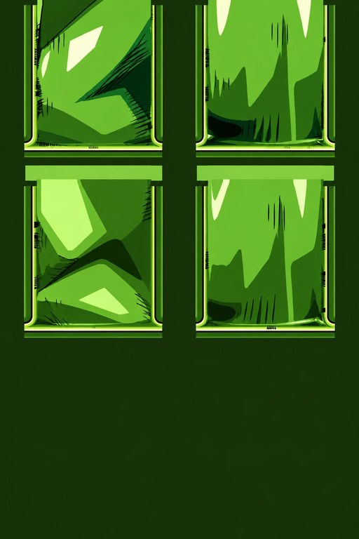
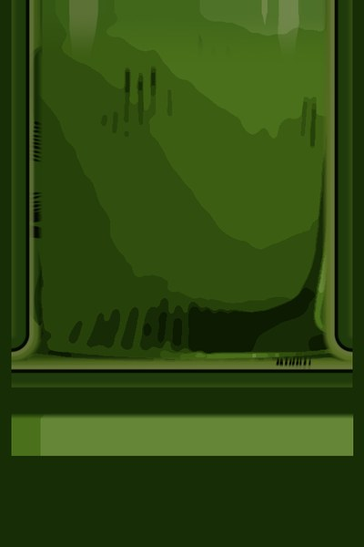
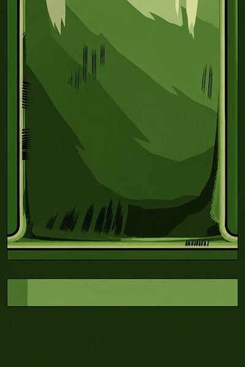
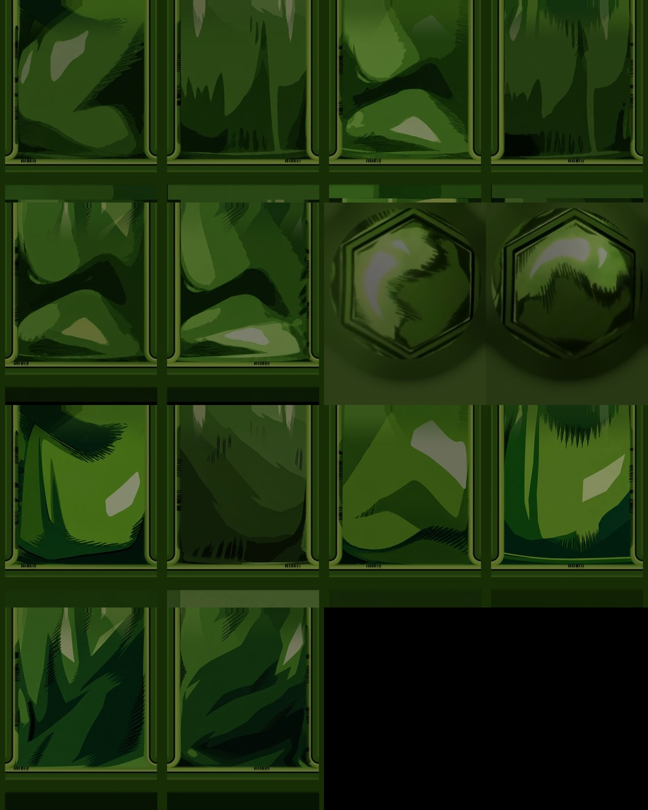

# Case study: turning an anime opening's steel ball into a paintable 3D texture

**Goal.** Make a three.js ball that looks like the CGI steel ball in the *Steel Ball Run* opening: flat cel
shading, thick black ink, black patches, bold white highlights, a soft fixed-light shadow. The look should come from
the show's own frames (not original art), and it should be hand-editable afterwards.

**Result.** A procedural groove mesh + a 14-cell hand-paintable ink atlas traced from the show's frames and
cleaned with a mix of scripts and an image generator, plus a shader that adds only a fixed shadow, motion blur and an
ink outline.

| g018 pose | palm-frame pose |
|---|---|
|  |  |

> Source frames are screenshots of the anime and are not reproduced in this document (they aren't in the images
> above). Comparisons below are described in words.

---

## 1. The ball is four layers, not one texture

The most useful idea in this project was separating what the show's artists drew from what a renderer should do:

| Layer | What it is | Where it lives |
|---|---|---|
| **Form** | Hexagon plates at the poles, a groove around each, six slots down the meridians. The grooves are real displaced geometry, so they catch the shader's lighting and silhouette. | `src/ball.atlas.js` (vertex height field) |
| **Paint + ink** | Greens, light/dark cel shapes, highlights, black patches, hatching and the ink along the groove edges. Painted once, stuck to the ball (object space), and it turns with the ball. | `src/assets/ink.png` |
| **Shadow** | One darkening from a *fixed* light, so it stays put while the ball spins. It is deliberately **not** baked into the paint. | shader, `src/assets/shade.json` |
| **Outline** | A slightly larger back-face shell in dark green; motion blur samples the ball over a short rotation. | `ball.atlas.js` |

**Texturing vs ink.** In the show, "ink" (black outlines, hatching, black cel patches) and "texturing" (green fills and
highlights) are both flat 2D art, so they live together in the same atlas. The *grooves* are the exception: their
channel/lip shape is geometry, and their black edge line is drawn into the atlas. That split matters because the
ink is view-dependent in the show (the animators redrew it per angle): blending several frames smeared it, while
copying a single frame per piece kept it crisp.

## 2. The approaches, in order

### Attempt 1: procedural starter art (kept as a groove source)
`scripts/make-ink.mjs` draws a starter atlas: gradients, a few smooth dark shapes, a glint, hatching. It looked
generic, but its **grooves** (clean channel, lip, ink line) turned out to be the best groove art we had.



### Attempt 2: cube-map bake from many frames (`bake2.py`, `ball.js`)
Project 13+ frames onto a cube map, blending by how head-on each is. **Problem:** the line work and black patches
change with angle in the show, so blending ghosted and swirled them. The result looked mushy and mismatched against
any single pose. Kept as a fallback (`ball.js`); it also silently drifted out of sync with the pose file after the
atlas work overwrote it.

### Attempt 3: trace one frame per piece into a paintable atlas (`bake_atlas.py`) ← the one that shipped

**3a. Know where the ball is in each frame.**
- *Circle*: detect the green disc (`lib.detect`, RANSAC on the green mask edge). For the later palm frame, the ball
  is partly hidden by fingers, so the circle was set by hand and checked visually.
- *Pose*: `fit.py` searches rotations so the model's groove ring lines up with the thin dark ink in the frame
  (random search, then a local refinement). Checked by drawing the groove lines over the frame.
- *Symmetry trap*: the groove layout has **12 rotational symmetries**, so a fit alone cannot say which panel is which.
  `track.py` picks the symmetric twin closest to the previous frame's pose along a motion chain, and the bake then
  searches the twin per chain that maximises head-on coverage.

**3b. One source frame per piece.** Each of the 14 pieces (6 north panel halves, 6 south halves, 2 hexagons) is
copied wholly from the frame that sees it most head-on, so ink stays crisp and unblended. Unseen texels are filled by
diffusing nearby colours.

**3c. Take the shadow out.** The frames have a fixed-light shadow baked in. `shade.py` fits it as a curve `g(dot(n, L))`
(9 knots, with `L` in view space), the bake divides it out (softened as `0.45 + 0.55·g`, stored at half scale so it
doesn't clip), and the shader multiplies it back as `paint × 2 × mix(1, g, strength)`. A *Shadow strength* slider
(default 0.25) exists because the user pointed out some frames (e.g. the palm shot) show almost no shadow at all.

### The problems, and how each was fixed

| Problem | Why | Fix |
|---|---|---|
| Panel grooves came out smeared and uneven | Frames see grooves small, oblique and blurry, and each panel copied its own version | Keep the traced paint but **redraw the groove band** (channel, lip, ink) from the clean procedural art, feathered at the edge |
| Panel paint blotchy and noisy | Blurry, angled source frames | Mean-shift smoothing, then k-means to ~7 flat colours, then a median pass for rounded edges (the "cel" look) |
| Panels differed in brightness | Each frame was lit differently and each piece divided by its own shadow estimate | Measure each cell's lit-green level and normalise; later: leave polished art alone and match the rest to it |
| Weak coverage for some panels | Frames rarely see them head-on | Added a new, large, clean, shadow-free frame (the palm shot) as a source: hand-set circle, auto-fit pose, mask out fingers/hat/lips |
| Hexagons looked good, panels didn't | Hexagons face the camera in several frames | Left hexagons as traced; spent the effort on panels |
| Panels were mirrored top/bottom | Atlas shortcut: north and south shared a cell | Atlas grew to 2048×2560 with separate cells 8–13 for south halves; shader and bake no longer mirror |
| Paint mismatched at the equator once unmirrored | North and south halves were polished separately and came back at different light levels | Match each pair's equator light level, then cross-fade ~120 px; equator row copied upward for clean filtering |
| Thin dotted line along the equator | Texture-coordinate jump between far-apart cells made the GPU pick the blurriest mip level | Compute derivatives from a seam-free coordinate and use `textureGrad` |

## 3. The image-generator polish step

The traced atlas had good structure but a vague, blurry look. We tried an image generator (ChatGPT) as an
image-to-image cleaner, with the palm frame as the style reference. What mattered:

- **Packing**: panels went in as grid sheets so a few generations covered many panels.
- **What worked**: the first sheet kept its layout and cleaned six panels (left = sent, right = returned):

   

- **What failed**: another sheet came back with panels redrawn or swapped (panels 2 and 4 were near-duplicates).
  The generator was pulling from earlier images in the same chat. Rejected:

  

- **Fix**: one panel per image, a fresh chat each time, and a one-line description of the panel's shapes. Those came
  back faithful (cell 9, sent left, returned right):

   

- **Alignment**: returned images drift slightly in scale and offset. We measured the black groove line in each
  returned sheet and re-cropped to the known layout. Without that the panel edges didn't line up with the groove
  overlay.

## 4. The final atlas

2048×2560, 14 cells of 512×640. Cells 0–5 north panel halves, 6/7 hexagons, 8–13 south panel halves. Layout is in
`src/inkAtlas.js` and `INK.md`.



## 5. What went wrong (and what we'd do differently)

- **Blending is the enemy of cel art.** Anything that averages frames (cube map, multi-frame blend) destroys the ink.
  One source per piece, no blending inside a piece.
- **Don't trust a single brightness statistic on cel art.** A percentile-of-luminance "lit level" misjudged cells with
  big dark ink patches and over-brightened them. Polished cells now keep their own brightness.
- **Mirroring was a cheap shortcut with a visible cost** (top/bottom symmetry), and removing it created a new seam to
  solve. Worth deciding the layout before painting 12 panels.
- **Generators contaminate across a chat.** Fresh chat per panel, and verify each returned image against the source
  before using it.
- **Don't overwrite shared data silently.** The atlas bake overwrote `frame-poses.json`/`shade.json`, which broke the
  older cube-map ball. Keep generated outputs per consumer.
- **Preview servers**: several dev servers can run for different projects on adjacent ports; confirm which one serves
  this folder before judging a render.

## 6. Known limits

- A few panel halves (e.g. cell 12) come from frames that barely see them, so their shapes are invented by the
  generator rather than copied.
- Brightness of polished halves is matched at the equator, which slightly shifts how some came back.
- Only a handful of poses were compared against the show frame-by-frame.
- The repo includes screenshots of the anime; consider removing them if it stays public.

## 7. How to reproduce / keep going

```bash
cd scripts/paint
python bake_atlas.py 1 1.9 7     # flatten passes, groove-band width, colours per panel
```

Polished cells are read from `polish/out/cellN.png` (512×640, full brightness, shadow-free). Hand-paint over
`src/assets/ink.png` only after committing, because the bake overwrites it. Pose and circle data are in
`scripts/paint/*.json`; the pasted palm frame is fitted by `fit_p016.py`.
